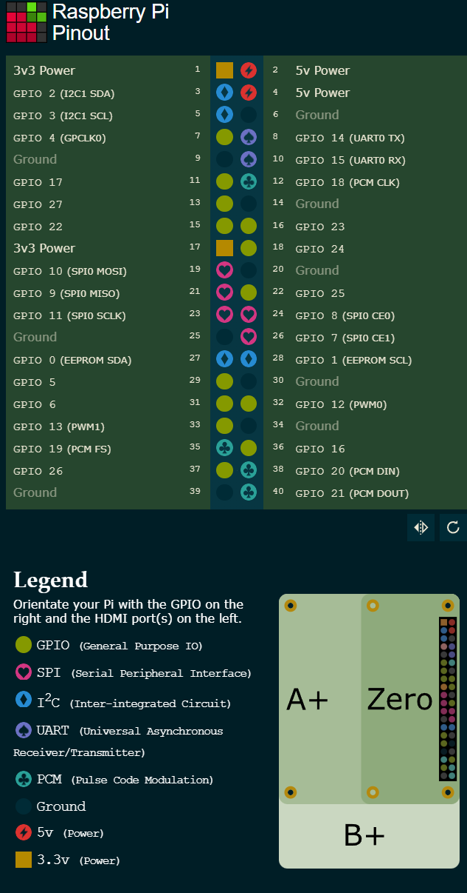

# SWU-Printer

A Star Wars: Unlimited (SWU) printer designed for a Momir-style game!

Inspired by some popular Momir-style printers for Magic: The Gathering (https://github.com/Stefan-Horst/MtG-Printer/tree/main https://www.youtube.com/watch?v=UA_lhvMBj6c).

Players set a cost and optional filters (arena and keyword), then press Print. A Raspberry Pi picks a random unit that matches the active player's aspects and prints it on a 58mm thermal printer, so it can be played in paper. Aspect lights on the front panel show each player's aspects.

**Status:** work in progress. The aspect lights, display, knobs, and buttons work. The printer is still to come, and this guide will grow as they're added.

## Contents

1. [Hardware setup](#hardware-setup): flash the microSD card, first boot, wire the aspect lights, knobs, buttons, display and button LEDs
2. [Software setup](#software-setup): connect over SSH, configure the Pi, get the code and card data
3. [Software tests](#software-tests): test each piece of hardware on its own, then run the simulator

---

## Hardware setup

### Parts so far

- Raspberry Pi 3 Model A+ (any Pi with the 40-pin header should work), a microSD card and optional heat sink
- A micro-USB power supply for the Pi while testing (2.5A)
- WS2811 5V pixel string (12mm bullet pixels). Only the first 11 pixels are used.
- 74AHCT14 hex inverter, to raise the LED data signal from 3.3V to 5V
- 4 KY-040 rotary encoders (the knobs), with knob caps
- 2 arcade buttons, a 30mm one for Print and a 24mm one for Utility, with 0.11" quick-connect wires. LED buttons are optional: their LEDs light the buttons, but the game works without them. These are Adafruit 3487 and 3430.
- Waveshare 2.42" OLED display (128×64, SSD1309, SPI), with its 7-wire cable
- Breadboard and jumper wires

### 1. Flash the microSD card

1. Put the microSD card in a card reader on your computer and open [Raspberry Pi Imager](https://www.raspberrypi.com/software/).
2. Choose:
   - **Device:** Raspberry Pi 3
   - **OS:** Raspberry Pi OS (other) → **Raspberry Pi OS Lite**. Lite has no desktop, and either 64-bit or 32-bit works.
   - **Storage:** your microSD card. Flashing erases it, including any NOOBS installer it shipped with.
3. When it offers to customize the settings, set:
   - **Hostname:** `swu-printer`
   - **Username and password**
   - **Wi-Fi name, password and country.** The A+ has no Ethernet port, so Wi-Fi is the only way in without a monitor and keyboard.
   - **SSH:** turned on, with password login

### 2. First boot

1. Fit the heat sink (optional). The Pi will end up inside a closed box.
2. Put the microSD card in the Pi and plug in the micro-USB power supply.
3. Give it a few minutes on the first boot, then continue with [Software setup](#software-setup).

### 3. Wire the aspect lights

**Shut down and unplug the Pi before wiring:** run `sudo shutdown -h now`, wait for the green light to stop blinking, then unplug it.

Header pins are numbered as in the diagram below. Hold the Pi with the header on the right, as in the diagram: pin 1 is at the top of the inner row, odd pins are on the inner row, and even pins are on the outer row along the board's edge.



*Pinout diagram from [pinout.xyz](https://pinout.xyz).*

| LED string wire | Pi header pin |
|---|---|
| 5V | pin 2 (5V) |
| Ground | pin 6 (Ground) |
| Data in | pin 12 (GPIO 18), through the 74AHCT14 as shown below |

- **Use the input end of the string.** The pixels usually have a small arrow that points away from the input. Wire colors vary, so go by the labels if there are any.
- **Count the pins carefully.** 5V on a GPIO pin can damage the Pi.

**74AHCT14 level shifter:** the Pi's 3.3V data signal is below what 5V pixels expect. That sometimes works, but it isn't reliable, so the 74AHCT14 raises it to 5V.

Put the chip on the breadboard across the center gap. With its notch pointing away from you, pin 1 is the top-left leg, pins 1–7 run down the left side, and pins 8–14 run back up the right side. Power it from one pair of the breadboard's edge rails: Pi pin 4 (5V) to the + rail and Pi pin 14 (Ground) to the − rail. Leave the rails on the other edge free.

| 74AHCT14 pin | Connect to |
|---|---|
| 14 (VCC) | + rail (5V) |
| 7 (GND) | − rail (Ground) |
| 1 (input 1A) | Pi pin 12 (GPIO 18) |
| 2 (output 1Y) | pin 3 |
| 4 (output 2Y) | LED string data in |
| 11, 13 (unused inputs) | − rail (Ground) |

Pins 5, 6, 8 and 9 are for the button LEDs, in [Wire the button LEDs](#6-wire-the-button-leds). If you skip those, connect pins 5 and 9 to the − rail as well, because a chip input left unconnected can switch at random.

The pixels light in this order along the chain. Pixel 0 is closest to the Pi:

| Pixel | Light | Color |
|---|---|---|
| 0 | Neutral | deep brown |
| 1 | Villainy | purple |
| 2 | Heroism | white |
| 3 | Cunning | yellow |
| 4 | Aggression | red |
| 5 | Command | green |
| 6 | Vigilance | blue |
| 7 | Vigilance ×2 | blue |
| 8 | Command ×2 | green |
| 9 | Aggression ×2 | red |
| 10 | Cunning ×2 | yellow |

On the front panel, pixels 0–6 form the bottom row from right to left, and pixels 7–10 run back across the top row above the four colors.

**Cutting the string:** once the panel layout is final, unplug everything and cut between the 11th and 12th pixels, keeping the input end. Tape over each cut wire on the 11-pixel piece, since they carry power. Keep the rest as spares.

### 4. Wire the knobs and buttons

**Shut down and unplug the Pi first.** The knobs run on **3.3V, never 5V**. Their boards pull their signal pins up to whatever powers them, so 5V would reach the Pi's GPIO pins and can damage them.

Use the pair of power rails on the **other edge** of the breadboard from the 74AHCT14:

- Pi **pin 1** (3.3V) → this edge's **+ rail**. Keep it apart from the 5V rail.
- A jumper from this edge's **− rail** to the 74AHCT14's − rail, so every ground on the board is shared.

**Knobs:** each KY-040 has five pins. On each one, **+ → 3.3V rail** and **GND → − rail**, then:

| Knob | CLK | DT | SW |
|---|---|---|---|
| Player | pin 11 (GPIO 17) | pin 15 (GPIO 22) | pin 16 (GPIO 23) |
| Cost | pin 29 (GPIO 5) | pin 31 (GPIO 6) | pin 33 (GPIO 13) |
| Arena | pin 38 (GPIO 20) | pin 40 (GPIO 21) | pin 32 (GPIO 12) |
| Keyword | pin 35 (GPIO 19) | pin 37 (GPIO 26) | pin 36 (GPIO 16) |

Only the player and cost knobs' pushes (SW) do anything in the game, but wiring all four leaves room for later.

**Buttons:** each button has one leg to a Pi pin and the other to ground. It doesn't matter which leg goes where.

| Button | Pi pin | Other leg |
|---|---|---|
| Print | pin 7 (GPIO 4) | − rail |
| Utility | pin 5 (GPIO 3) | − rail |

- **LED buttons have four terminals.** Two are the switch and two are the LED. To find the switch, set a multimeter to continuity (the beep setting): the pair that beeps only while the button is pressed is the switch.
- The quick-connect wires end in a 2-pin female socket. Push a male-to-male jumper into each of its two holes, then run one jumper to the Pi pin and the other to the − rail.
- The utility button is on GPIO 3 because pressing a button on that pin wakes a Pi that has been shut down.

### 5. Wire the display

**Shut down and unplug the Pi first.** The display runs on **3.3V**, the same rail as the knobs. It also accepts 5V, but 3.3V keeps its logic at the Pi's level.

The display's cable has seven wires. Go by the labels printed on the display's board, since wire colors can vary:

| Display pin | Usual wire color | Goes to |
|---|---|---|
| VCC | red | 3.3V **+ rail** |
| GND | black | **− rail** |
| DIN | blue | pin 19 (GPIO 10) |
| CLK | yellow | pin 23 (GPIO 11) |
| CS | orange | pin 24 (GPIO 8) |
| DC | green | pin 18 (GPIO 24) |
| RST | white | pin 22 (GPIO 25) |

- The display ships set to SPI. Don't change the resistors on its back, which switch it to I2C.
- Pins 22 and 24 are easy to swap. If they are, the screen stays black.

### 6. Wire the button LEDs

This step is optional. The buttons' LEDs need 5V, which a Pi pin can't supply, so each one runs from the 5V rail through one of the 74AHCT14's spare inverters. Setting the Pi pin high lights the LED, and the game can dim it.

**Shut down and unplug the Pi first.** If chip pins 5 and 9 are connected to the − rail, remove those jumpers first.

Push a male-to-male jumper into each hole of the LED's quick-connect socket (the LED terminals, not the switch ones). Plug each chip connection into a free hole in that chip pin's breadboard row.

| Button | LED + wire | LED's other wire | Pi pin → chip pin |
|---|---|---|---|
| Print | 5V + rail | chip pin 8 | pin 13 (GPIO 27) → chip pin 9 |
| Utility | 5V + rail | chip pin 6 | pin 3 (GPIO 2) → chip pin 5 |

- **An LED only works one way round.** On ours the + wire was grey on Print and white on Utility, but check yours: if an LED stays dark in the test, swap its two jumpers. Backwards does no harm.
- **The Utility LED lights as soon as the Pi has power**, and stays lit while the Pi is shut down. GPIO 2 has a built-in pull-up, which keeps the pin high whenever no software is using it. That makes the red button glow exactly when pressing it would wake the Pi.
- The Print LED doesn't do this. GPIO 27 defaults low, so Print stays dark until the software lights it. If it lights by itself, check the jumper into chip pin 9. A loose one leaves the input floating.

---

## Software setup

Commands marked **PC** run in a terminal on your computer (PowerShell on Windows). Commands marked **Pi** run on the Pi over SSH. Replace `<username>` with the username you set in Imager.

### 1. Connect over SSH

**PC:**
```powershell
ssh <username>@swu-printer.local
```
Type `yes` if it asks whether to trust the host. Your password doesn't show as you type it. If `swu-printer.local` isn't found, look up the Pi's IP address in your router's device list and use that instead.

### 2. Update the Pi and install git

**Pi:**
```bash
sudo apt update && sudo apt full-upgrade -y
sudo apt install -y git
python3 --version
```
The code needs Python 3.10 or newer. The upgrade can take a while, so don't unplug the Pi partway through.

### 3. Configure the Pi's hardware

These settings free up the pins the printer, display and lights use.

| Setting | Why |
|---|---|
| `enable_uart=1` | Turns on the serial port the printer uses |
| `dtoverlay=disable-bt` | Turns off Bluetooth, which otherwise takes the main serial port from the printer |
| `dtparam=spi=on` | Turns on SPI, which the display uses |
| `dtparam=audio=off` | Turns off analog audio, which shares the hardware that drives the lights on GPIO 18 |

**Pi:**
```bash
sudo sed -i 's/^dtparam=audio=on/dtparam=audio=off/' /boot/firmware/config.txt
printf 'enable_uart=1\ndtoverlay=disable-bt\ndtparam=spi=on\ndtparam=audio=off\n' | sudo tee -a /boot/firmware/config.txt
sudo raspi-config
```
In `raspi-config`, go to **Interface Options → Serial Port**. Choose **No** for a login shell over serial and **Yes** to keep the serial hardware on. This stops Linux from sending login text to the printer. Finish, then reboot with `sudo reboot` and reconnect.

Check the settings worked:
```bash
ls -l /dev/serial0 /dev/spidev*
```
`serial0` should point to `ttyAMA0`, and `/dev/spidev0.0` and `/dev/spidev0.1` should be listed.

### 4. Clone the code

**Pi:**
```bash
git clone https://github.com/jkf735/SWU-Printer.git
cd SWU-Printer
```
To get updates later, run `git pull` in the same folder. Don't edit the project files on the Pi, or `git pull` can refuse to run. If you want to make edits I encourage you to clone this project and make it your own!

### 5. Make the Python environment

Everything on the Pi runs with one Python environment in the project folder. `--system-site-packages` lets it also use libraries installed through `apt`.

**Pi:**
```bash
python3 -m venv --system-site-packages ~/SWU-Printer/.venv
~/SWU-Printer/.venv/bin/pip install rpi_ws281x luma.oled
sudo apt install -y python3-gpiozero python3-lgpio
```
The `apt` line is for the knobs and buttons. Raspberry Pi OS usually has these already, in which case it changes nothing.
If the install fails while building, run `sudo apt install -y python3-dev build-essential` and try again.

### 6. Get the card data and print images

The card list and the processed print images aren't in git, because they're generated. Make them on your computer, which is much faster than the Pi, then copy them over. You need Python 3.10 or newer and Pillow (`pip install Pillow`).

**PC**, in the project folder:
```powershell
python -m swu_momir.data.cards
python -m tools.prepare_images
```
The first command downloads every unit and token from [SWU-DB](https://www.swu-db.com/api) and saves `cache/cards.json`. The second downloads each card image and makes a black-and-white print version in `cache/prints/`. The first run takes a few minutes and about 400 MB for the original images, which stay on your computer. Later runs only process new cards.

Then copy the two things the Pi needs, about 25 MB in total. **PC:**
```powershell
ssh <username>@swu-printer.local "mkdir -p SWU-Printer/cache"
scp -r cache/cards.json cache/prints <username>@swu-printer.local:SWU-Printer/cache/
```
Copy only these two. The rest of `cache/` is desktop-only and much larger.

---

## Software tests

Run these on the Pi from the project folder (`cd ~/SWU-Printer`).

### Unit tests

These check the game logic and need no hardware:
```bash
python3 -m unittest discover -s tests -t .
```
All tests should pass. They also run on your computer with `python` instead of `python3`.

### Aspect lights

With the lights wired as in [Wire the aspect lights](#3-wire-the-aspect-lights):
```bash
sudo .venv/bin/python -m tools.led_test
```
The LEDs need root, so it has to run with `sudo`. The pixels light one at a time in chain order, then the Vigilance light blinks the way the setup cursor will. The terminal names each pixel as it lights. Press **Ctrl+C** to stop it, which also turns the lights off.

If something looks wrong, the settings are at the top of `swu_momir/hw/leds.py`:

| Problem | Fix |
|---|---|
| Nothing lights | Check the wiring first, especially that data is on pin 12 and reaches the string's input end. |
| Red and green are swapped | Change `ws.WS2811_STRIP_RGB` to `ws.WS2811_STRIP_GRB`. |
| Flickering or random colors | Change `FREQUENCY` to `400_000`. |
| Too bright or too dim | Change `BRIGHTNESS` (out of 255). |

### Knobs and buttons

With the knobs and buttons wired as in [Wire the knobs and buttons](#4-wire-the-knobs-and-buttons):
```bash
.venv/bin/python -m tools.input_test
```
This one doesn't need `sudo`. The terminal shows each event the game would get. Press **Ctrl+C** to stop.

- **Knobs:** each click should count exactly 1, with + for clockwise and − for counterclockwise. A running count per knob helps spot skipped clicks.
- **Player knob push:** a click shows "Player push" when you let go. Holding it for 1 second shows "Player hold", and letting go after a hold shows nothing.
- **Cost knob push:** shows "Cost push" right away.
- **Utility button:** a press shows "Utility press" a moment later, because it waits to rule out a double-press. Two quick presses show "Utility double-press". Holding it for 2 seconds shows the long press.
- **Print button:** shows "Print" right away. Presses in the next 2 seconds are ignored, so a double-click can't print twice.
- **The arena and keyword knobs' pushes** show "push (unused)". They do nothing in the game, so this just checks their wiring.

If something looks wrong, the settings are at the top of `swu_momir/hw/inputs.py`:

| Problem | Fix |
|---|---|
| A knob counts the wrong way | Add it to `REVERSED`, for example `frozenset({Knob.COST})`. |
| A knob does nothing | Check its + is on the 3.3V rail, its GND on the − rail, and its CLK and DT pins. |
| A knob counts only every second click | Some encoders send half a step per click. That needs a change to the driver. |
| Quick double-presses come through as two single presses | Raise `DOUBLE_PRESS_SECONDS`. Lower it if single presses feel slow. |
| `No module named 'gpiozero'` | Run the `apt` line from [Make the Python environment](#5-make-the-python-environment). |

### Display

With the display wired as in [Wire the display](#5-wire-the-display):
```bash
.venv/bin/python -m tools.oled_test
```
This doesn't need `sudo`. The screen first shows a border around its edge, then three sample screens the way the game draws them, each named in the terminal. It turns off after 15 seconds, or sooner with **Ctrl+C**.

| Problem | Fix |
|---|---|
| The screen stays black | Check VCC and GND, then check that CS is on pin 24 and RST on pin 22, not swapped. |
| Garbled or shifted text | DC and RST are probably swapped. |
| The border is cut off on one side | The display isn't lined up with the driver. That needs a change to the driver. |
| Text is too big or too small | Change `DISPLAY_FONT_SIZES` in `swu_momir/render.py`. |
| `No module named 'luma'` | Run the `pip` line from [Make the Python environment](#5-make-the-python-environment). |
| `No module named 'RPi'` | Run `sudo apt install -y python3-rpi-lgpio`. |

### Button LEDs

With the button LEDs wired as in [Wire the button LEDs](#6-wire-the-button-leds):
```bash
.venv/bin/python -m tools.button_led_test
```
Before it runs, the red Utility LED should already be lit and the green Print LED dark. The test lights Print, then Utility, each at 100%, 50%, 20% and 5% brightness, then blinks both. When it ends, Utility lights again by itself and Print stays dark.

In the game, Print is lit whenever pressing it would print, and goes dark while a card prints and for 2 seconds after. Utility is lit only when pressing it is the way forward: in token mode (to exit) and while the Pi is shut down (to wake it). The simulator's `--controls` option lights them this way.

| Problem | Fix |
|---|---|
| An LED stays dark | It's backwards. Swap its two jumpers. |
| The Print LED lights by itself | The jumper from Pi pin 13 to chip pin 9 is loose. |
| An LED flickers when dimmed | The dimming runs in software. Report it, since the game's brightness setting may need to change. |

### Simulator

The simulator runs the machine's logic in the terminal, with keys standing in for the knobs and buttons. It shows the lights and the display as text. This is useful for tests while building when all components may not be integrated yet or to pinpoint specific failures.

On your computer:
```powershell
python -m tools.sim
```
On the Pi, add `--lights` to also show the aspect lights on the real LEDs:
```bash
sudo .venv/bin/python -m tools.sim --lights
```
Without `--lights`, it doesn't need `sudo`.

Add `--display` to also show the display on the real OLED, and `--controls` to play with the real knobs and buttons and light the button LEDs. The keys keep working too. With everything:
```bash
sudo .venv/bin/python -m tools.sim --lights --display --controls
```

| Control | Keys |
|---|---|
| Player knob (left, right) | `q` `w` |
| Cost knob | `e` `r` |
| Arena knob | `t` `y` |
| Keyword knob | `u` `i` |
| Player knob push / hold | `a` / `s` |
| Cost knob push | `d` |
| Print button | Space |
| Utility button: press / double-press / long-press | `z` / `x` / `c` |
| Quit | Esc |

Printed cards are saved to `cache/last_print.png`, so keep that file open in an image viewer or editor tab to see each print. Over SSH, the status line names the card instead. Player settings are saved to `cache/state.json`, and the real machine uses the same file, so delete it for a clean start.

To set a player's aspects: turn the player knob to P1 or P2 (`q` or `w`), hold the player knob (`s`), move the cursor with the cost knob (`e` and `r`), press the cost knob (`d`) to change the selected aspect, then press the player knob (`a`) to save. Utility (`z`) in setup starts that player over.
