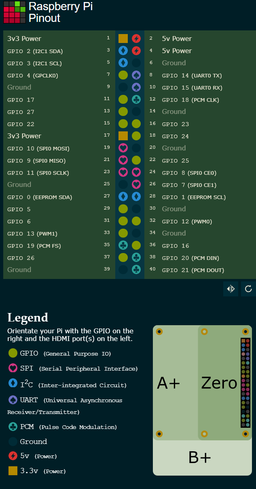

# SWU-Printer

A Star Wars: Unlimited (SWU) printer, inspired by the popular Momir-style printers for Magic: The Gathering.

Players set a cost and optional filters (arena and keyword), then press Print. A Raspberry Pi picks a random unit that matches the active player's aspects and prints it on a 58mm thermal printer, so it can be played in paper. Aspect lights on the front panel show each player's aspects.

**Status:** work in progress. The aspect lights work. The knobs, buttons, display and printer are still to come, and this guide will grow as they're added.

## Contents

1. [Hardware setup](#hardware-setup): flash the microSD card, first boot, wire the aspect lights
2. [Software setup](#software-setup): connect over SSH, configure the Pi, get the code and card data
3. [Software tests](#software-tests): test each piece of hardware on its own, then run the simulator

---

## Hardware setup

### Parts so far

- Raspberry Pi 3 Model A+ (any Pi with the 40-pin header should work), a microSD card and optional heat sink
- A micro-USB power supply for the Pi while testing (2.5A)
- WS2811 5V pixel string (12mm bullet pixels). Only the first 11 pixels are used.
- 74AHCT14 hex inverter, to raise the LED data signal from 3.3V to 5V
- Breadboard and jumper wires

### 1. Flash the microSD card

1. Put the microSD card in a card reader on your computer and open [Raspberry Pi Imager](https://www.raspberrypi.com/software/).
2. Choose:
   - **Device:** Raspberry Pi 3
   - **OS:** Raspberry Pi OS (other) → **Raspberry Pi OS Lite**. Lite has no desktop, and either 64-bit or 32-bit works.
   - **Storage:** your microSD card. Flashing erases it, including any NOOBS installer it shipped with.
3. When it offers to customize the settings, set:
   - **Hostname:** `swu-printer`
   - **Username and password**
   - **Wi-Fi name, password and country.** The A+ has no Ethernet port, so Wi-Fi is the only way in without a monitor and keyboard.
   - **SSH:** turned on, with password login

### 2. First boot

1. Fit the heat sink (optional). The Pi will end up inside a closed box.
2. Put the microSD card in the Pi and plug in the micro-USB power supply.
3. Give it a few minutes on the first boot, then continue with [Software setup](#software-setup).

### 3. Wire the aspect lights

**Shut down and unplug the Pi before wiring:** run `sudo shutdown -h now`, wait for the green light to stop blinking, then unplug it.

Header pins are numbered as in the diagram below. Hold the Pi with the header on the right, as in the diagram: pin 1 is at the top of the inner row, odd pins are on the inner row, and even pins are on the outer row along the board's edge.



*Pinout diagram from [pinout.xyz](https://pinout.xyz).*

| LED string wire | Pi header pin |
|---|---|
| 5V | pin 2 or 4 (5V) |
| Ground | pin 6 (Ground) |
| Data in | pin 12 (GPIO 18), through the 74AHCT14 as shown below |

- **Use the input end of the string.** The pixels usually have a small arrow that points away from the input. Wire colors vary, so go by the labels if there are any.
- **Count the pins carefully.** 5V on a GPIO pin can damage the Pi.

**74AHCT14 level shifter:** the Pi's 3.3V data signal is below what 5V pixels expect. That sometimes works, but it isn't reliable, so the 74AHCT14 raises it to 5V. Each of its gates inverts the signal, so the data goes through two gates and comes out the right way up:

| 74AHCT14 pin | Connect to |
|---|---|
| 14 (VCC) | 5V |
| 7 (GND) | Ground |
| 1 (input 1A) | Pi pin 12 (GPIO 18) |
| 2 (output 1Y) | pin 3 |
| 4 (output 2Y) | LED string data in |
| 5, 9, 11, 13 (unused inputs) | Ground |

The pixels light in this order along the chain. Pixel 0 is closest to the Pi:

| Pixel | Light | Color |
|---|---|---|
| 0 | Neutral | deep brown |
| 1 | Villainy | purple |
| 2 | Heroism | white |
| 3 | Cunning | yellow |
| 4 | Aggression | red |
| 5 | Command | green |
| 6 | Vigilance | blue |
| 7 | Vigilance ×2 | blue |
| 8 | Command ×2 | green |
| 9 | Aggression ×2 | red |
| 10 | Cunning ×2 | yellow |

On the front panel, pixels 0–6 form the bottom row from right to left, and pixels 7–10 run back across the top row above the four colors.

**Cutting the string:** once the panel layout is final, unplug everything and cut between the 11th and 12th pixels, keeping the input end. Tape over each cut wire on the 11-pixel piece, since they carry power. Keep the rest as spares.

---

## Software setup

Commands marked **PC** run in a terminal on your computer (PowerShell on Windows). Commands marked **Pi** run on the Pi over SSH. Replace `<username>` with the username you set in Imager.

### 1. Connect over SSH

**PC:**
```powershell
ssh <username>@swu-printer.local
```
Type `yes` if it asks whether to trust the host. Your password doesn't show as you type it. If `swu-printer.local` isn't found, look up the Pi's IP address in your router's device list and use that instead.

### 2. Update the Pi and install git

**Pi:**
```bash
sudo apt update && sudo apt full-upgrade -y
sudo apt install -y git
python3 --version
```
The code needs Python 3.10 or newer. The upgrade can take a while, so don't unplug the Pi partway through.

### 3. Configure the Pi's hardware

These settings free up the pins the printer, display and lights use.

| Setting | Why |
|---|---|
| `enable_uart=1` | Turns on the serial port the printer uses |
| `dtoverlay=disable-bt` | Turns off Bluetooth, which otherwise takes the main serial port from the printer |
| `dtparam=spi=on` | Turns on SPI, which the display uses |
| `dtparam=audio=off` | Turns off analog audio, which shares the hardware that drives the lights on GPIO 18 |

**Pi:**
```bash
sudo sed -i 's/^dtparam=audio=on/dtparam=audio=off/' /boot/firmware/config.txt
printf 'enable_uart=1\ndtoverlay=disable-bt\ndtparam=spi=on\ndtparam=audio=off\n' | sudo tee -a /boot/firmware/config.txt
sudo raspi-config
```
In `raspi-config`, go to **Interface Options → Serial Port**. Choose **No** for a login shell over serial and **Yes** to keep the serial hardware on. This stops Linux from sending login text to the printer. Finish, then reboot with `sudo reboot` and reconnect.

Check the settings worked:
```bash
ls -l /dev/serial0 /dev/spidev*
```
`serial0` should point to `ttyAMA0`, and `/dev/spidev0.0` and `/dev/spidev0.1` should be listed.

### 4. Clone the code

**Pi:**
```bash
git clone https://github.com/jkf735/SWU-Printer.git
cd SWU-Printer
```
To get updates later, run `git pull` in the same folder. Don't edit the project files on the Pi, or `git pull` can refuse to run. If you want to make edits I encourage you to clone this project and make it your own!

### 5. Make the Python environment

Everything on the Pi runs with one Python environment in the project folder. `--system-site-packages` lets it also use libraries installed through `apt`.

**Pi:**
```bash
python3 -m venv --system-site-packages ~/SWU-Printer/.venv
~/SWU-Printer/.venv/bin/pip install rpi_ws281x
```
If the install fails while building, run `sudo apt install -y python3-dev build-essential` and try again.

### 6. Get the card data and print images

The card list and the processed print images aren't in git, because they're generated. Make them on your computer, which is much faster than the Pi, then copy them over. You need Python 3.10 or newer and Pillow (`pip install Pillow`).

**PC**, in the project folder:
```powershell
python -m swu_momir.data.cards
python -m tools.prepare_images
```
The first command downloads every unit and token from [SWU-DB](https://www.swu-db.com/api) and saves `cache/cards.json`. The second downloads each card image and makes a black-and-white print version in `cache/prints/`. The first run takes a few minutes and about 400 MB for the original images, which stay on your computer. Later runs only process new cards.

Then copy the two things the Pi needs, about 25 MB in total. **PC:**
```powershell
ssh <username>@swu-printer.local "mkdir -p SWU-Printer/cache"
scp -r cache/cards.json cache/prints <username>@swu-printer.local:SWU-Printer/cache/
```
Copy only these two. The rest of `cache/` is desktop-only and much larger.

---

## Software tests

Run these on the Pi from the project folder (`cd ~/SWU-Printer`).

### Unit tests

These check the game logic and need no hardware:
```bash
python3 -m unittest discover -s tests -t .
```
All tests should pass. They also run on your computer with `python` instead of `python3`.

### Aspect lights

With the lights wired as in [Wire the aspect lights](#3-wire-the-aspect-lights):
```bash
sudo .venv/bin/python -m tools.led_test
```
The LEDs need root, so it has to run with `sudo`. The pixels light one at a time in chain order, then the Vigilance light blinks the way the setup cursor will. The terminal names each pixel as it lights. Press **Ctrl+C** to stop it, which also turns the lights off.

If something looks wrong, the settings are at the top of `swu_momir/hw/leds.py`:

| Problem | Fix |
|---|---|
| Nothing lights | Check the wiring first, especially that data is on pin 12 and reaches the string's input end. |
| Red and green are swapped | Change `ws.WS2811_STRIP_RGB` to `ws.WS2811_STRIP_GRB`. |
| Flickering or random colors | Change `FREQUENCY` to `400_000`. |
| Too bright or too dim | Change `BRIGHTNESS` (out of 255). |

### Simulator

The simulator runs the machine's logic in the terminal, with keys standing in for the knobs and buttons. It shows the lights and the display as text. This is useful for tests while building when all components may not be integrated yet or to pinpoint specific failures.

On your computer:
```powershell
python -m tools.sim
```
On the Pi, add `--lights` to also show the aspect lights on the real LEDs:
```bash
sudo .venv/bin/python -m tools.sim --lights
```
Without `--lights`, it runs on the Pi with plain `python3 -m tools.sim`.

| Control | Keys |
|---|---|
| Player knob (left, right) | `q` `w` |
| Cost knob | `e` `r` |
| Arena knob | `t` `y` |
| Keyword knob | `u` `i` |
| Keyword knob push / hold | `o` / `p` |
| Print button | Space |
| Utility button: press / double-press / long-press | `z` / `x` / `c` |
| Quit | Esc |

Printed cards are saved to `cache/last_print.png`, so keep that file open in an image viewer or editor tab to see each print. Over SSH, the status line names the card instead. Player settings are saved to `cache/state.json`, and the real machine uses the same file, so delete it for a clean start.

To set a player's aspects: turn the player knob to P1 or P2 (`q` or `w`), hold the keyword knob (`p`), move the cursor with `u` and `i`, press `o` to change the selected aspect, then press utility (`z`) to save.
